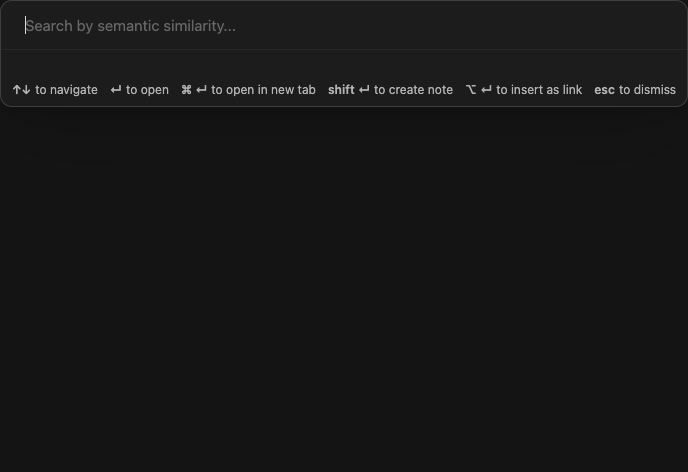

# Similar Notes for Obsidian

[](https://buymeacoffee.com/joybro)

Find semantically similar notes using AI. Choose local models for privacy or cloud APIs for flexibility.

### Similar Notes View

When you open a note, similar notes appear at the bottom of it, and they refresh as you edit.


### Semantic Search

Press `Cmd+Shift+O` (or `Ctrl+Shift+O`) to search your vault by meaning, not just keywords.



## Features

- **Flexible Options**: Run locally (100% private) or use cloud APIs like OpenAI
- **Mobile & Desktop**: Works on iOS, Android, and all desktop platforms (on mobile, a cloud API is the default; see Getting Started)
- **OpenAI Support**: Use OpenAI embedding models or any OpenAI-compatible API
- **Ollama Support**: Connect to custom models via Ollama (desktop; on mobile only with an Ollama server your phone can reach over the network)
- **No Setup Required on Desktop**: Built-in models work out of the box, no API keys needed

## Getting Started

1. Install the plugin
2. On desktop, the default model downloads automatically (one-time, about 90 MB)
3. Your notes will be indexed in the background
4. Similar notes will appear at the bottom of your current note

Progress appears in the status bar.

> **On mobile**: new installs start with the OpenAI provider, because built-in models can crash Obsidian on phones with little memory. Add an OpenAI (or OpenAI-compatible) API key in settings, or switch to Gemini. You can still choose a built-in model in settings if your device has enough memory.

## Model Options

### Built-in Models (Mobile & Desktop)

Supports any Sentence Transformer model from Hugging Face that ships ONNX weights. Local processing, no API keys required.

**Recommended:**

- `all-MiniLM-L6-v2` (English, default)
- `paraphrase-multilingual-MiniLM-L12-v2` (multilingual)

> **Custom models**: The plugin uses Transformers.js, which requires ONNX weights. Many Hugging Face repos only ship PyTorch / safetensors and will fail to load. For other models, look for an ONNX-converted version under the [`onnx-community`](https://huggingface.co/onnx-community) organization, or use the Ollama / OpenAI providers instead.

> **Mobile note**: Large models may cause crashes due to memory limits. Consider using the default model or OpenAI API on mobile.

### OpenAI / Compatible API

Supports any OpenAI-compatible embedding API.

**Recommended:**

- `text-embedding-3-small`

> **Note for CJK users**: For Chinese, Japanese, and Korean text, multilingual models like `bge-m3` (via Ollama) often outperform OpenAI models in both quality and token efficiency.

#### Using OpenRouter

[OpenRouter](https://openrouter.ai) offers embedding models from multiple vendors through one OpenAI-compatible API, often at very low cost (a whole vault typically indexes for well under a dollar). Configure it through the OpenAI provider:

1. **Model provider**: OpenAI API
2. **Server URL**: `https://openrouter.ai/api/v1`
3. **API key**: your OpenRouter key (`sk-or-...`)
4. **Model**: Custom model..., then enter the model ID from OpenRouter (e.g. `perplexity/pplx-embed-v1-0.6b`, `qwen/qwen3-embedding-8b`, or `openai/text-embedding-3-small`)
5. Use **Test connection** to verify before Load & Apply.

> **Privacy note**: OpenRouter routes your note content to the model vendor, and each vendor has its own data retention policy. OpenRouter accounts have a Zero Data Retention (ZDR) option that restricts routing to providers who confirmed they do not store your data; requests that would hit a non-ZDR endpoint fail with an error instead of going through silently. If your vault contains sensitive material, enable it once at [openrouter.ai/settings/privacy](https://openrouter.ai/settings/privacy) (Data Policies, Zero Data Retention) before indexing. It applies account-wide, so no plugin configuration is needed. (Thanks to David Torrens for testing OpenRouter and researching the ZDR setting.)

### Ollama (Desktop)

Supports any Ollama embedding model. Ollama runs on your computer, so on mobile it works only if you point the server URL at an Ollama server your phone can reach over the network. Since 1.8.0 the plugin calls Ollama through Obsidian's own request API, so you don't need to set `OLLAMA_ORIGINS` for a server on another computer.

**Recommended:**

- `nomic-embed-text` (English)
- `bge-m3` (multilingual)

## Agent Usage

The active note's similar-notes results can be exported to a JSON file, so an external coding agent can reuse the plugin's similarity search without understanding embeddings or plugin internals:

1. Open a note in Obsidian.
2. Run the command **Similar Notes: Export similar notes for active note**.
3. Read the results from `.obsidian/plugins/similar-notes/similar-notes-export.json`.

Output format (success):

```json
{
  "version": 1,
  "ok": true,
  "sourcePath": "Projects/My Note.md",
  "generatedAt": "2026-06-09T12:34:56.000Z",
  "results": [
    {
      "path": "Knowledge/Related Note.md",
      "title": "Related Note",
      "score": 0.82,
      "excerpt": "similar content..."
    }
  ]
}
```

On error (e.g. no active markdown file, search failure), the same file is written with `{ "version": 1, "ok": false, "code": "...", "error": "..." }`, where `code` is `NO_ACTIVE_FILE` or `SEARCH_FAILED`.

For driving the command from an agent (CLI flow, validation tips, drop-in skill snippet), see [docs/agent-export.md](docs/agent-export.md).

## Technical Details

- **Transformers.js**: Runs Hugging Face models directly in Obsidian
- **WebGPU**: GPU acceleration on desktop, automatic CPU fallback
- **Orama**: Built-in vector database for fast search
- **Web Workers**: Built-in model inference and vector search run in background threads

## Network Use and Bundled Code

The plugin makes network requests only for the provider you choose:

- **Built-in models (default)**: downloads the model files from `huggingface.co` the first time a model is loaded, and the ONNX Runtime WebAssembly file (`ort-wasm-simd-threaded.jsep.wasm`, part of [Transformers.js](https://github.com/huggingface/transformers.js) / [ONNX Runtime Web](https://github.com/microsoft/onnxruntime)) from `cdn.jsdelivr.net`. Both are cached; your notes are not sent anywhere. The model picker also reads model details from the `huggingface.co` API.
- **OpenAI-compatible, Gemini, Ollama**: sends note text to the server URL you configure (by default `api.openai.com`, `generativelanguage.googleapis.com`, or `localhost:11434`).
- **github.com**: only the "Report a bug" button in settings, which opens this repository's issue page in your browser.

There is no telemetry or analytics. The WebAssembly file runs the built-in embedding model; it is not part of this repository's source. Release assets (`main.js`, `manifest.json`, `styles.css`) are built by GitHub Actions from this repository and, from 1.8.0 on, carry GitHub artifact attestations.

## Multi-Device Usage

This plugin stores its index locally in IndexedDB, which is device-specific storage that **does not sync** across devices.

**What this means:**

- Each device maintains its own independent index
- Obsidian Sync, iCloud, Syncthing, or any other file sync tool will **not sync the index**
- When you open your vault on a new device, the plugin will automatically index your notes from scratch

This is by design - IndexedDB provides fast, reliable local storage that doesn't interfere with vault syncing.

**Settings are different**: the plugin's settings, including any OpenAI or Gemini API key, are saved in plain text in `.obsidian/plugins/similar-notes/data.json` inside your vault. A vault sync tool can copy that file to your other devices (and to wherever your vault is backed up).

## License

[MIT](LICENSE)
